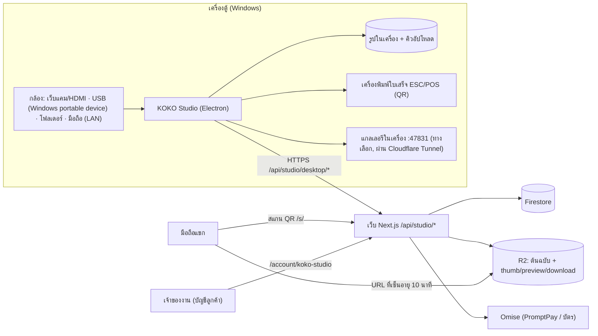

# KOKO Studio / KOKO Memory — Architecture, data model, API

สรุป: ระบบมี 2 ส่วน คือ **โปรแกรมตู้** (Electron, repo `PhotoboothKoKo`) ที่ถ่าย เก็บรูปในเครื่อง พิมพ์ใบเสร็จ QR
และส่งรูปขึ้นเบื้องหลัง กับ **เว็บ** (Next.js, repo นี้ branch `feat/photo-delivery-m1-m2`) ที่ออกสิทธิ์ใช้งาน เก็บรูปบน
ที่เก็บแบบ S3 (Cloudflare R2) และแสดงหน้ารูปของแขก ข้อมูลอยู่ใน Firestore อัปเดตเอกสารนี้ 2026-11-20 จากโค้ดจริง

## ภาพรวม

หลักสำคัญ (Master Prompt หัวข้อ 4–5)
- **Offline-first:** รอบถ่ายและลิงก์ของรอบสร้างในเครื่องก่อน ใบเสร็จพิมพ์ได้ทันทีโดยไม่รออัปโหลด รูปขึ้นเบื้องหลังและลองใหม่เองเมื่อเน็ตกลับ
- **รูปเป็นส่วนตัว:** bucket ไม่เปิดสาธารณะ ทุกการอ่านผ่าน URL ที่เซ็นอายุสั้น หรือผ่าน route ที่ตรวจโทเค็น
- **แยกข้อมูลตามบัญชี:** ทุกคำขอฝั่งลูกค้าผูกกับ `ownerUid` ของผู้ล็อกอิน (ทดสอบใน `tests/studio/tenant-isolation.test.ts`)

## โปรแกรมตู้ (Electron main process)

| ส่วน | ไฟล์ | หน้าที่ |
|---|---|---|
| เก็บรูป | `src/main/services/photo-store.ts` | บันทึก JPEG ลงโฟลเดอร์ที่เลือก, ดัชนี, กันนำเข้าซ้ำด้วย sha256 |
| รอบถ่าย | `capture-session-store.ts`, `capture-authorization.ts` | รอบ (เริ่ม/ตรวจ/ยืนยัน/ยกเลิก) และสิทธิ์ถ่ายตามจำนวนรูปของรอบ |
| ถ่ายที่ตัวกล้อง | `photo-folder-watcher.ts`, `camera-usb-import.ts`, `phone-camera-server.ts` | รับรูปจากโฟลเดอร์ / USB (Windows Shell) / มือถือ แล้วผูกเข้ารอบที่รออยู่ (`externalRoundAuthorization` ใน `index.ts`) |
| คลาวด์ | `studio-cloud-client.ts`, `studio-cloud-recovery.ts`, `retry-backoff.ts` | ลงทะเบียนรอบ, ขอ URL อัปโหลด, ยืนยัน, ลองใหม่ทุกนาที |
| แกลเลอรีในเครื่อง | `guest-gallery-server.ts`, `gallery-token-store.ts` | หน้า `/s/<token>` จากเครื่องตู้ เมื่อไม่มีคลาวด์หรืออัปโหลดไม่สำเร็จ |
| ใบเสร็จ | `escpos-receipt.ts`, `receipt-printers.ts` | ESC/POS ผ่าน Windows spooler / LAN 9100 / COM, ข้อความไทยเป็นภาพ 1-bit |
| สิทธิ์ใช้งาน | `license-runtime.ts`, `license-verifier.ts` | ตรวจลายเซ็นสิทธิ์ด้วยกุญแจสาธารณะที่ฝังตอน build (`vite.main.config.mjs`) |

## Data model (Firestore)

| คอลเลกชัน | ใช้ทำอะไร |
|---|---|
| `studioPlans` | แพ็กเกจ: ราคา, รอบบิล, ฟีเจอร์ (`cloud_sync` ฯลฯ), จำนวนเครื่อง, โควตาพื้นที่, วันเก็บรูป |
| `studioLicenses` | สิทธิ์ของเครื่อง/บัญชี: `ownerUid`, `planId`, สถานะ, วันหมดอายุแผน, อุปกรณ์ที่ใช้ |
| `studioDeviceAuthorizations`, `studioLinkCodes` | การผูกเครื่องกับบัญชีด้วยรหัสยืนยัน |
| `studioLicenseKeys`, `studioPilot` | คีย์สิทธิ์แบบกรอกเอง, โควตาผู้ทดลองใช้ |
| `studioEvents` | งานของลูกค้า: ชื่อจากตู้, `guestTitle`/`guestMessage` ที่เจ้าของตั้งบนเว็บ, จำนวนรูป, ขนาด |
| `studioSessions` | รอบถ่ายจากตู้ (จำนวนรูปที่คาดไว้, ลิงก์ของรอบ) |
| `studioPhotos` | รูป: key ใน R2, ขนาด, sha256, สถานะ `pending/ready/hidden/deleted`, รูปย่อที่สร้างแล้ว |
| `studioUsage` | พื้นที่และจำนวนรูปที่ใช้ต่อบัญชี (ใช้ตรวจโควตา) |
| `studioShares`, `studioShareIndex`, `studioShortCodes` | ลิงก์แชร์ (ทั้งงาน / ต่อรอบ), PIN, รหัส 8 ตัวใต้ QR |
| `studioOrders`, `studioPaymentEvents` | คำสั่งซื้อแพ็กเกจและเหตุการณ์จาก Omise (กันซ้ำ) |
| `studioReleases`, `studioDownloads`, `studioStatsDaily` | ตัวติดตั้งที่เผยแพร่, สถิติดาวน์โหลด, สถิติรายวัน |
| `studioAuditLogs` | บันทึกการกระทำสำคัญ (ลบรูป, ซ่อน, ให้สิทธิ์) |
| `studioRateLimits`, `studioIdempotency`, `studioSchema` | จำกัดความถี่, กันคำขอซ้ำ, เวอร์ชันโครงสร้าง (migration) |

ไฟล์ใน R2: ต้นฉบับ `studio/<ownerUid>/<event>/<photo>.jpg` และรูปย่อ `.thumb.webp` (~400 px), `.preview.webp` (~1600 px), `.download.jpg` (ไฟล์ที่ปุ่มบันทึกใช้)

## API (`/api/studio/<path>`, ไฟล์ `src/lib/studio/http.ts`)

การยืนยันตัวตน: `account/*` และ `admin/*` ใช้ Firebase ID token (admin ต้องมีสิทธิ์ผู้ดูแล), `desktop/*` ใช้ลายเซ็นสิทธิ์ของเครื่อง,
`share/*` ใช้โทเค็นในลิงก์ (+ PIN ถ้าตั้ง), `cron/*` ใช้ `x-cron-secret` ทุก POST ฝั่งบัญชีต้องมี `Origin` ตรงกับ `STUDIO_WEB_ORIGIN`
และมีการจำกัดความถี่ต่อ path ต่อผู้เรียก

| ผู้เรียก | GET | POST |
|---|---|---|
| สาธารณะ | `health`, `readiness`, `releases/latest`, `download`, `desktop/plans`, `desktop/updates` | `share/view`, `share/code`, `share/photo`, `billing/omise/webhook` |
| โปรแกรมตู้ | – | `desktop/licenses/free/claim`, `desktop/licenses/activate`, `desktop/licenses/deactivate`, `desktop/leases/refresh`, `desktop/device-authorizations`, `desktop/device-authorizations/poll`, `desktop/cloud/events`, `desktop/cloud/sessions`, `desktop/cloud/shares`, `desktop/cloud/shares/revoke`, `desktop/cloud/photos/init`, `desktop/cloud/photos/confirm`, `desktop/photo-folders` |
| ลูกค้า | `account/licenses`, `account/cloud/events`, `account/cloud/photos?eventId=`, `account/billing/plans`, `account/billing/orders`, `account/billing/order?orderId=` | `account/link`, `account/licenses/manage`, `account/pilot/start`, `account/cloud/shares`, `account/cloud/photos/manage`, `account/cloud/photos/delete-many`, `account/cloud/events/update`, `account/billing/checkout` |
| ผู้ดูแล | `admin/licenses`, `admin/releases`, `admin/stats`, `admin/cloud/events`, `admin/cloud/photos` | `admin/licenses/grant`, `admin/licenses/manage`, `admin/releases`, `admin/cloud/photos/manage`, `admin/cloud/retention-sweep`, `admin/cloud/derivatives/backfill` |
| งานตั้งเวลา | `monitor/snapshot` | `cron/retention-sweep` |

`purchase` ปิดไว้ (คืนข้อผิดพลาด) การซื้อใช้ `account/billing/checkout` แทน

## เอกสารที่เกี่ยวข้อง
- ติดตั้ง/ขึ้นเซิร์ฟเวอร์: `deploy/hostinger/README.md`, `docs/VPS_READINESS_2026-11-20.md`
- สำรอง/กู้คืน: `docs/BACKUP_RESTORE.md` · เฝ้าระวัง: `docs/MONITORING.md`
- ต้นทุน: `docs/COST_PER_EVENT_2026-11-19.md` · สัญญาอนุญาต/ช่องโหว่: `docs/LICENSES_AND_SECURITY_2026-11-20.md`
- คู่มือหน้างาน (repo PhotoboothKoKo): `docs/RUNBOOK_ONSITE_TH.md`, `docs/GUEST_GALLERY_TUNNEL.md`
- ผลทดสอบ: `docs/TEST_REPORT_2026-11-20.md`
